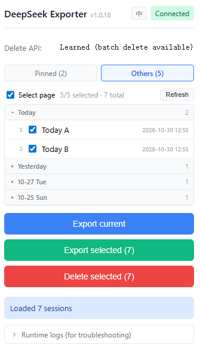
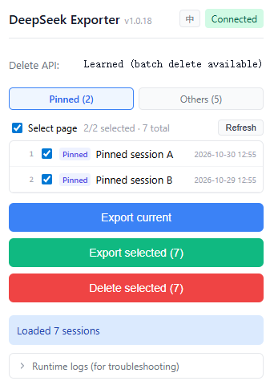

# deepseek-chat-exporter

> [中文文档](README_ZH.md) | **English**

A chat history management & offline viewing tool for DeepSeek Web (`chat.deepseek.com`) — browse conversations, batch-export, batch-delete, and read offline. Contains two sub-projects:

| Sub-project | Directory | Tech Stack | Description | Download |
|--------|------|--------|------|------|
| Chrome Extension (manager) | `extension/` | Manifest V3 + TypeScript + [plain-framework](https://benoly520.github.io/plain-framework/) + esbuild | Session manager: browse / batch-export / batch-delete chats, export to structured JSON | **[⬇ Latest build zip](https://github.com/benoly520/deepseek-chat-exporter/raw/main/extension/deepseek-chat-exporter-extension.zip)** |
| Viewer (presentation) | `viewer/` | [plain-framework](https://benoly520.github.io/plain-framework/) + markdown-it + highlight.js | Offline viewer: import exported JSON, browse as chat bubbles | — |

> See the Software Design Document (SDD, in Chinese) at [doc/spec/deepseek-chat-exporter_sdd.spec.md](doc/spec/deepseek-chat-exporter_sdd.spec.md), revised to match the current implementation (v1.2.3). Defect post-mortems and change proposals live in [doc/bugfix/](doc/bugfix) and [doc/change/](doc/change).

## Preview

Session manager popup — pinned / non-pinned tabs, with the non-pinned list grouped by day (collapsible, latest day expanded by default):



Pinned tab — pinned sessions listed on their own page, each row carrying a “pinned” badge:



## Features

### Chrome Extension (manager)

- **Session manager**: opening the popup automatically loads the **full** session list with pagination (keyset paging — not limited by per-page size), each row shows index / title / date; select all or individual
- **Export current session**: export the conversation you are viewing
- **Batch export selected**: merge checked sessions into a single JSON, with live progress (N/total + title + percentage)
- **Batch delete sessions**: learned delete endpoint (manually delete any session once on the page and the extension "learns" it), custom confirmation dialog, rate-limited one-by-one replay
- **Fault-tolerant content extraction**: multi-level probing (top-level fields / fragment arrays / deep scan), compatible with the nested message structure of the v0 API, keeps the thinking process
- **Runtime logs**: content/SW logs aggregated and persisted (survives SW suspension); fetch / download / copy / clear; log header carries the extension version
- **Diagnostics panel**: API capture diagnostics (recent `/api/` request URLs) and log panel as unified collapsible cards
- **Visible status**: popup shows the extension version, connection status, and delete-endpoint learning state
- **Friendly errors**: clear prompts for not-logged-in / expired session, page not refreshed (not connected), no active tab, etc.
- **Anti-rate-limit throttling**: pauses 800ms every 5 requests, 300ms between list pages; deletions run one by one

### Viewer (presentation)

- **Import**: drag & drop / multi-select; multiple files merged and de-duplicated by conversation id
- **Browse**: chat bubble layout with a session sidebar (sorted by update time, descending)
- **Rendering**: Markdown (code highlight / tables / quotes) + collapsible thinking blocks
- **Search**: full-text filtering by title and message content
- **Offline & safe**: pure front-end local parsing, zero upload
- **Bilingual UI**: switch between Chinese and English at runtime without reload (choice persisted);
  error messages and relative times follow the selected language

## Directory Structure

```
deepseek-chat-exporter/
├── doc/                # Design docs: spec / change / bugfix, images for screenshots
├── extension/          # Chrome extension
│   ├── manifest.json   # MV3 manifest
│   ├── build.js        # Build script (Vite for popup + esbuild for content/background)
│   ├── scripts/        # Dev tooling: preview.mjs (local popup preview) + preview-data.json
│   ├── icons/
│   └── src/
│       ├── popup/      # UI shown when clicking the extension icon (plain / TSX)
│       ├── content/    # content script: fetch hook injection, route watching, API proxy
│       ├── background/ # service worker: export orchestration (pagination + throttling)
│       ├── types/
│       └── utils/
└── viewer/             # Viewer (plain-framework)
    ├── index.html
    └── src/
        ├── components/ # FileLoader / ConversationList / ChatView
        ├── utils/      # json-parser / date-format / markdown
        ├── state.ts    # module-level signal state
        └── App.tsx
```

## Chrome Extension Usage

### Download & Install (recommended, no build needed)

The extension zip is maintained in the repository: every local `pnpm build` automatically
re-packages `dist` into `extension/deepseek-chat-exporter-extension.zip` (committed with the code).
Download the latest build via the direct link:

**[⬇ Download deepseek-chat-exporter-extension.zip](https://github.com/benoly520/deepseek-chat-exporter/raw/main/extension/deepseek-chat-exporter-extension.zip)**

Unzip it, then follow the "Install" steps below and load the unzipped directory.

### Build

```bash
cd extension
pnpm install
pnpm build
```

### Local Preview (no extension install, no login)

The popup depends on `chrome.*` APIs, so opening its HTML directly gives you a blank page. The
repo ships a preview harness that fakes those APIs and serves the **real `dist/` output**:

```bash
cd extension
pnpm build      # preview always serves a fresh build
pnpm preview    # → http://127.0.0.1:8934/
```

Use it to check layout, group collapsing, tab switching and language switching, or to take
README screenshots — no Chrome extension install and no DeepSeek login required.

`scripts/preview.mjs` copies `dist/` to `.preview/` (git-ignored, rebuilt on every start),
generates a `mock-chrome.js`, injects it *before* the popup bundle, and serves the directory
over HTTP (`file://` would be blocked by CORS). The mock only fakes what the popup actually
calls — `runtime.getManifest`, `runtime.sendMessage`, `runtime.onMessage`,
`i18n.getUILanguage`, `storage.local` — so a newly added dependency on an undeclared API still
fails loudly instead of being silently mocked. Export / delete actions are not simulated; they
just log to the console.

Mock data lives in [`extension/scripts/preview-data.json`](extension/scripts/preview-data.json):

| Field | Meaning |
|-------|---------|
| `lang` | Initial UI language: `en` or `zh` |
| `connected` | Whether the header shows "Connected" |
| `deleteTemplateReady` | Whether the delete endpoint is reported as learned |
| `currentSessionId` | Id of the session treated as currently open |
| `sessions[]` | `id` / `title` / `pinned` / `updatedDaysAgo` |

Sessions are described as "N days ago" rather than absolute timestamps, so the day-group headers
stay correct over time. Edit the file and restart `pnpm preview` to take effect.

### Install

1. Open `chrome://extensions`
2. Enable "Developer mode"
3. Click "Load unpacked" and select the unzipped directory (or the locally built `extension/dist` directory)

### Export & Session Management

1. Open [chat.deepseek.com](https://chat.deepseek.com) and log in (if the extension was installed after the page, refresh the page once)
2. Click the extension icon — the popup is the session manager:
   - Automatically loads the **full** session list with pagination (keyset paging, not limited by per-page size); each row shows index / title / date
   - **Export current session**: export the conversation you are viewing
   - **Export selected**: all selected by default; checked sessions are merged into a single JSON (throttled: pauses 800ms every 5 requests, live progress)
   - **Delete selected**: batch delete (learned, see below); requires a custom confirmation dialog — irreversible

### Batch Delete (learned)

The delete endpoint is used internally by the DeepSeek page — undocumented and irreversible, so the
extension does not hard-code it: first **manually delete any session on the page**, and the extension
automatically captures that real request as a template (persisted). After that you can batch-delete
from the popup. The "Delete endpoint" status at the top of the popup shows whether it has been learned.

## Viewer Usage

```bash
cd viewer
pnpm install
pnpm dev         # dev: http://localhost:5180
pnpm build       # output in viewer/dist
```

After opening the page, drag in the JSON exported by the extension (or click to select; multi-file
merge is supported) to browse by conversation, search, and render Markdown and thinking processes.

> The `plain` dependency of both sub-projects points to a local `plain-framework` repository via
> `link:` (see each `package.json`, [docs](https://benoly520.github.io/plain-framework/)).
> Make sure that repository has run `pnpm install && pnpm run build` first. Both use pnpm.

## Exported JSON Format

```json
{
  "export_meta": {
    "exporter": "deepseek-chat-exporter",
    "version": "1.0.0",
    "exported_at": "2026-10-20T08:30:00.000Z",
    "source": "chat.deepseek.com"
  },
  "conversations": [
    {
      "id": "5a298e61-4fd4-455b-9aaf-7c6142d727a0",
      "title": "Conversation title",
      "model": "deepseek-chat",
      "created_at": "...",
      "updated_at": "...",
      "messages": [
        { "role": "user", "content": "...", "created_at": "..." },
        { "role": "assistant", "content": "...", "thinking": "...", "created_at": "..." }
      ]
    }
  ]
}
```

## Security Notes

- All requests are made by the user's own browser, only calling the same APIs the DeepSeek page itself uses; no data is sent to any third party
- The only write operation is "delete session": executed only after the user explicitly checks items and confirms twice, replaying the page's real request shape one by one
- The viewer is a pure front-end app; JSON files are parsed locally only
